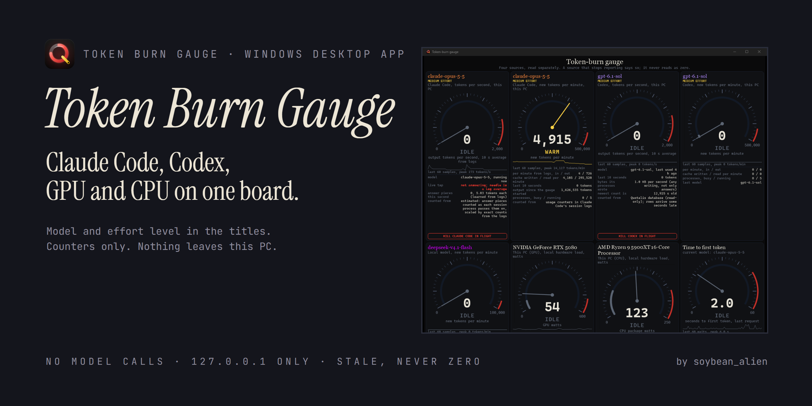
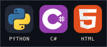

<p align="center"></p>

# Token Burn Gauge

A small Windows desktop app that shows, on eight dials, how fast your AI tools are burning tokens and what your PC is doing while they do it. It reads counters and timestamps only. It never calls a model and never reads what you or the model wrote.

## What it shows

| Module | Reading | Where it comes from |
|---|---|---|
| Claude Code, per second and per minute | tokens, titled with the running model and its effort level | Claude Code's own session logs on this PC |
| Codex, per second and per minute | tokens, titled with the running model and its effort level | [Quotalis](https://github.com/soybean-alien/Quotalis)'s local database, opened read-only |
| GPU | watts, titled with the card's name | `nvidia-smi`, once a second |
| CPU | watts, titled with the processor's name | Windows counters |
| Time to first token | seconds | a local tap on your own requests |
| Local model, per minute | tokens, titled with the model's name | a usage export [Quotalis](https://github.com/soybean-alien/Quotalis) keeps on this PC (`usage_export_path` in `config.json`), opened read-only; it moves once a minute |

Model names are coloured by tier: purple for the top tier, then orange, yellow and blue. Effort levels use the same four colours. The tiers are one line each in `config.json` (`model_tiers`, `effort_tiers`).

Claude Code, Codex and local generation each have a stop button, and the local model dial has pause and resume. Every button needs two clicks: the first arms it for three seconds.

## Rules it keeps

- No model calls anywhere in the pipeline.
- Counters and timestamps only. Message and tool content is never read.
- Every server listens on `127.0.0.1` only.
- Other programs' data is opened read-only and never changed.
- A source that stops answering shows STALE or OFFLINE, never zero.
- Money figures are marked "estimated".

## Install

Needs Windows 10 or 11, the [.NET 10 Desktop Runtime](https://dotnet.microsoft.com/download/dotnet/10.0) and [Python 3.12 or newer](https://www.python.org/downloads/) on `PATH` (the collectors use the standard library only).

1. Build the installer (see below) or take `TokenBurnGauge-Setup-<version>.exe` from a release.
2. Run it. It installs for your user only, with no administrator rights, to `%LOCALAPPDATA%\Programs\TokenBurnGauge`.
3. Start **Token Burn Gauge** from the Start menu. The app starts its own collectors if they are not running.

Settings live in `config.json` beside the app. The installer writes it once from `config.example.json` and never overwrites it; uninstalling keeps it.

## How it is built

- **The app** (`app/TokenGauge`): C#, .NET 10, Windows Forms. It draws the dials itself with GDI+, with no browser engine, and reads four JSON files from `http://127.0.0.1:8830/` once a second.
- **The collectors** (`collector_b.py`, `agents.py`, `tap.py`, `proxy.py`): Python, standard library only. They sample the sources above and serve the JSON.
- **The page** (`gauge.html`): the same dials in a browser, kept as a fallback.
- **The remote collector** (`remote/`): optional; see `remote/DEPLOY.md`.

## Build and test

```powershell
python -m unittest discover -s tests
dotnet build app\TokenGauge -c Release
powershell -ExecutionPolicy Bypass -File tools\build-installer.ps1
```

The last command needs [Inno Setup 6](https://jrsoftware.org/isinfo.php) and writes the installer and its SHA-256 to `artifacts\`.

## Credits and AI disclosure

- Made by **soybean_alien**. Licensed under the **MIT License** (see [LICENSE](LICENSE)).
- Built on [.NET](https://github.com/dotnet/runtime) and [Windows Forms](https://github.com/dotnet/winforms), with [Python](https://www.python.org/) for the collectors and [Inno Setup](https://jrsoftware.org/isinfo.php) for the installer.
- Token Burn Gauge is an unofficial personal tool. It isn't affiliated with Anthropic, OpenAI, NVIDIA or AMD.
- **AI disclosure:** Token Burn Gauge was designed with and written by **Claude Code (Anthropic, Claude Fable 5.2)**, directed and tested by the author on Windows 11. The dials were checked against live Claude Code and Codex sessions on the author's PC; the installer has been built but not yet tested on a second PC.
